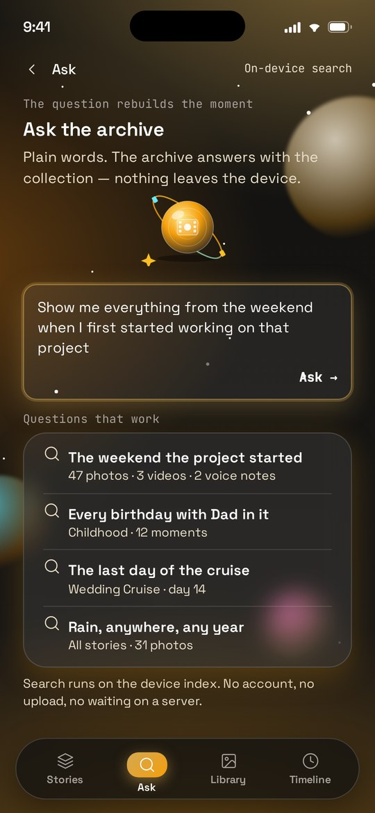
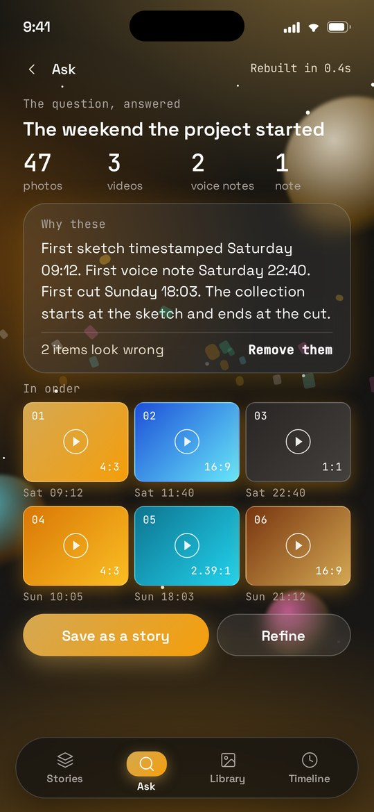
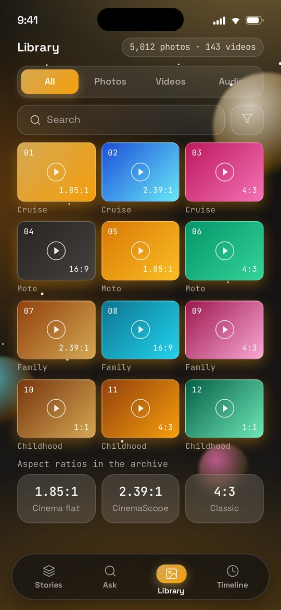
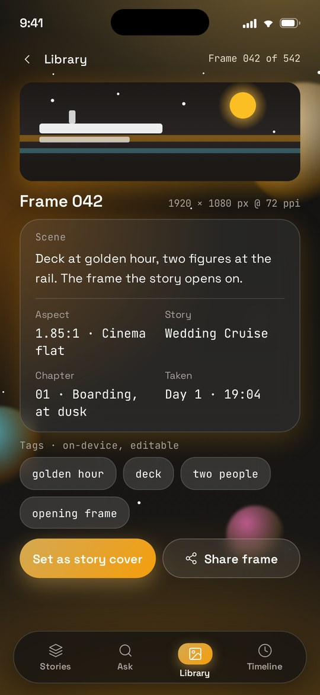
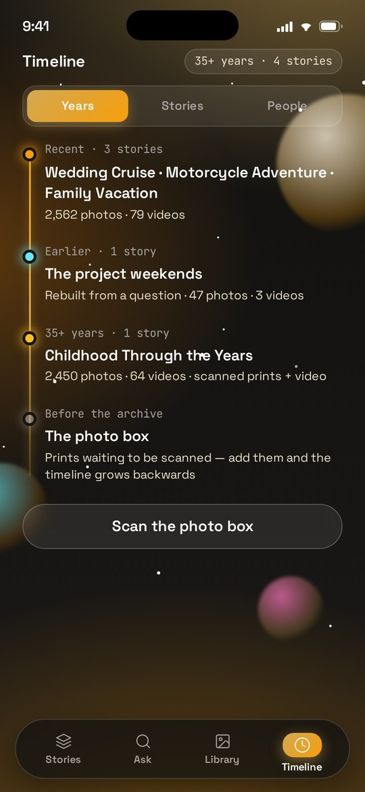

  

<h1 align="center">PALIMPSEST</h1>

<strong>Your life, as an editable memory.</strong>

Every media library answers "when did I save this?" — and fails at the question you actually ask. PALIMPSEST is memory that answers back: ask for a moment in plain words and the archive rebuilds it from your photos, videos, voice notes, and notes, in order, with the reason each piece is there. Nothing is ever overwritten — every edit writes a new layer, and the older layers stay visible beneath, like the manuscript the app is named for.

<a href="https://mr-vishwet.github.io/palimpsest/"><strong>Try the live demo →</strong></a>

---

- **Ask** — describe a moment the way you'd tell a friend; the archive searches by meaning, time, people, and place
- **Reconstructed moments** — the pieces come back in order, each with its reason for being there, ready to save as a story
- **The Library** — the cutting room: every photo, video, voice note, and note in one grid, filterable by type
- **Frame detail** — open any frame for its scene, tags, story, and chapter — and pick it as a story cover
- **Timeline** — 35+ years of stories on one line, plus the photo box: prints waiting to be scanned in
- **On your device** — the demo archive holds 5,012 photos · 143 videos · 9 voice notes, and **0 bytes uploaded**

  
  
  
  
  

