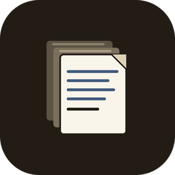
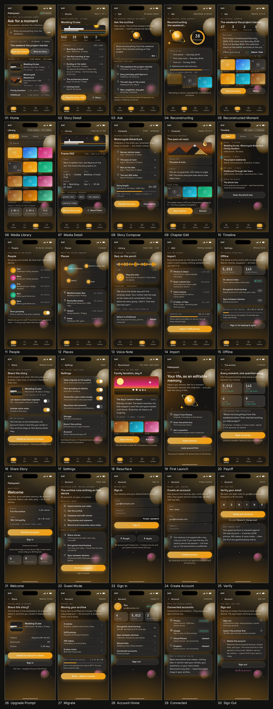
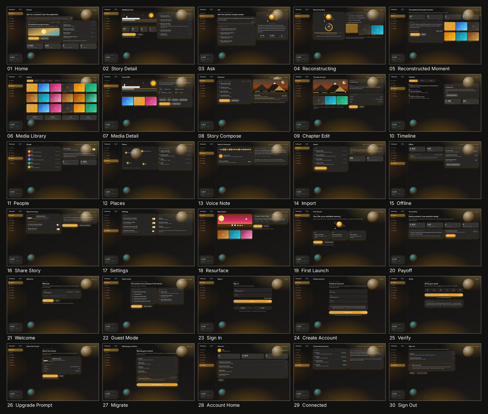

  

<h1 align="center">PALIMPSEST</h1>

<strong>Your life, as an editable memory.</strong>

A personal archive of photos, videos, voice memos, and notes spanning decades — one you can ask for a moment in plain words, and watch it rebuild the moment, in order, with the reason each piece is there.

<a href="https://mr-vishwet.github.io/palimpsest/"><strong>Try the live demo →</strong></a>

---

## The idea

Every media library answers "when did I save this?" — and fails at the question you actually ask: *"show me the weekend when I first started working on that project."* Folders, dates, and filenames remember storage. They don't remember life.

PALIMPSEST starts from a different idea: your archive should answer back. Ask for a moment the way you'd describe it to a friend, and the archive searches by meaning, time, people, and place — then rebuilds the moment from the pieces it finds: photos, videos, voice notes, and notes, in chronological order, each with its reason for being there.

The name is the product. A palimpsest is a manuscript written over older writing, where the earlier layers are still visible beneath. Nothing in your archive is ever overwritten: every edit to a caption, a tag, or a cover writes a new layer on top, and the older layers stay visible underneath. You can always peel the top layer back and see what was there before — because memory isn't a single draft, it's the layers.

And everything it finds can be traced. Every item in a rebuilt moment links back to its source in your archive, so an answer is never a black box: you can see exactly where each photo, clip, and note came from, and why the archive chose it.

It all happens on your device. The demo shows it plainly: **0 bytes uploaded.** Search, stories, edits, and export never leave the device — your life's archive is yours, and it stays yours.

## What it does

### Ask — memory that answers back

Type a question in plain words — *"Show me everything from the weekend when I first started working on that project"* — and watch the archive reconstruct the moment. The Reconstructing screen shows the search gathering pieces; the Reconstructed Moment shows them in order, each with its reason: the first sketch, the first voice note, the first cut — the whole weekend, as it happened.

If something looks wrong, flag it. Removing an item teaches the archive what you meant, and the correction is remembered, so the next time you ask, the moment comes back truer. A rebuilt moment can be saved as a story with one tap.

### Stories — the moments, in the order you remember them

The demo archive holds four stories — **Wedding Cruise** (Mediterranean Sea, 14 days), **Motorcycle Adventure** (Rocky Mountains, 2,185 miles), **Family Vacation**, and **Childhood** — each built from chapters you arrange in the order you remember them, dragging to reorder. A story plays its chapters in sequence, with its total length shown up front (the Wedding Cruise runs 4:52 across five chapters). Chapters carry their own titles, captions, and covers, and any chapter can be edited or re-covered without ever touching the originals.

### The Library — the cutting room

The Library is where the raw archive lives: every photo, video, voice note, and written note in one grid, filterable by type. It's called the cutting room because that's what it is — the place you pull frames from when you're building a story. Open any frame and you see its full detail: when and where it was captured, its tags, the people in it, the story it belongs to, and its layer history — every edit ever made to it, with the older versions still there beneath.

### Timeline, People, Places

The **Timeline** spans 35+ years of the archive, with stories placed by their start year — and the photo box: the place for printed photos, scanned in and sorted into the archive alongside everything else.

**People** groups faces on your device, and the names are yours to add — the demo archive has Dad, Mum, Ana, Ravi, and Sara, plus one unnamed group waiting for a name. **Places** is a schematic map of where your life happened: the Mediterranean Sea, the Rocky Mountains, Hawaii, home.

### Voice notes you can search

Voice memos live in the archive as first-class memories, with a waveform and a transcript — so a spoken note is as searchable as a written one. A voice note from a porch in 1998 can sit in the same rebuilt moment as the photos from that weekend, and you can play it right there.

### Edit in layers

Nothing is ever overwritten. Change a caption, retag a photo, pick a new cover — each edit becomes a new layer on top of the old one, and the layer history shows the whole stack. Reverting peels the top layer off to reveal what was there before. The palimpsest metaphor isn't decoration; it's how editing works.

### Import — bring your own archive

Import is how media enters the archive: photos and videos from your photo library, prints scanned from a photo box, voice memos with on-device transcription, or a whole folder of files, sorted by date and then by story. Import shows honest progress as it works — how much of the new batch is indexed, and how much has been uploaded (none).

The demo opens on a sample archive — 5,012 photos, 143 videos, and 9 voice notes across the four stories — so every flow, including Import, is explorable as designed.

### Resurface — three years ago this week

Every so often the archive offers a moment back: *three years ago this week*, a day from Family Vacation, a morning from Childhood. Not a notification demanding attention — a quiet invitation to open the day, or to pass it by.

### Share, on your terms

A story can be shared as a view-only link, with the choice of whether viewers can download originals or hear the voice notes. Sharing needs an account — the archive asks you to sign in at that point, and not before.

### Guest-first, offline by nature

No account is needed. The whole archive works as a guest: ask, browse, curate, edit, export. Signing in unlocks only three things: share links, encrypted cloud backup, and sync between devices. Offline isn't a failure state — the archive runs entirely on the device, so it works with no connection at all. And when you sign out, your local archive stays; only the cloud copy goes.

## The interface

PALIMPSEST has 30 screens, designed as one continuous flow — from the first launch and the Ask flow, through the Library, Timeline, People, Places, and voice notes, to sharing, settings, and the guest and account flows.

**Mobile — all 30 screens**

**Web — all 30 screens**

